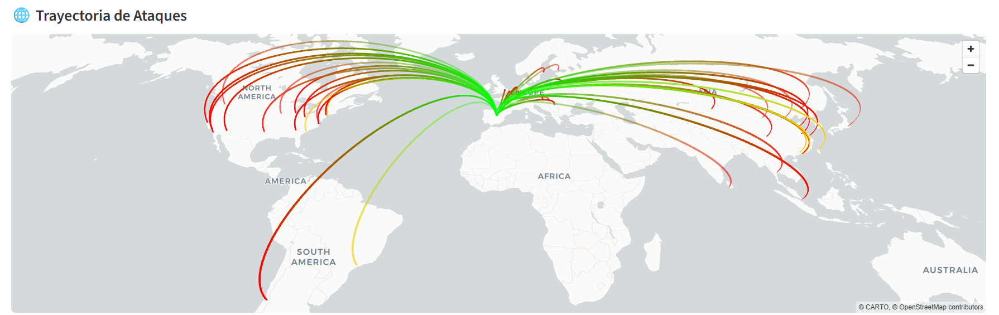

# SSH Honeypot with Real-Time Threat Dashboard

Bachelor's thesis project (Information Systems Engineering, Universidad de Alcalá, 2026).

A low-interaction SSH honeypot written in Python that records every connection attempt, enriches each event with **geolocation** and **IP reputation**, stores it in SQLite and shows it live on a **Streamlit** dashboard with a 3D map of attack origins. I deployed it on a public cloud server and analysed real internet traffic for two experimental phases.



## What it does

- **Sensor** (`src/main.py`): a multithreaded TCP server that listens on port 2222, presents a fake OpenSSH banner and records the first payload each client sends.
- **Threat intelligence**: each source IP is enriched with country, ISP and coordinates ([IPinfo](https://ipinfo.io)) and an abuse confidence score from 0 to 100 ([AbuseIPDB](https://www.abuseipdb.com)). Private and invalid addresses are not sent to the reputation API.
- **Storage**: SQLite in WAL mode, so the sensor can write while the dashboard reads.
- **Dashboard** (`src/dashboard.py`): Streamlit + pandas + PyDeck. Aggregated metrics, an arc map (colour by risk level, red above 50) and a raw log view, refreshed every 3 seconds.
- **Cowrie importer** (`src/cowrie_db.py`): reads the JSON log of the [Cowrie](https://github.com/cowrie/cowrie) medium-interaction honeypot and loads login attempts and executed commands into the same database, so the dashboard shows both sources together. It keeps a cache of already queried IPs to save API quota and a log of processed events so it can be re-run safely.
- **Simulator** (`src/simulador.py`): injects 50 fake events so the dashboard can be tried without exposing a server.

```
 attacker ──SSH──▶  main.py (sensor)  ──┐
 attacker ──SSH──▶  Cowrie ─▶ cowrie_db.py ─┤──▶ IPinfo + AbuseIPDB ──▶ SQLite ──▶ dashboard.py
                                            │                           (honeypot.db)    (Streamlit)
 simulador.py (fake data for demos) ────────┘
```

## Quick start (demo, no API keys needed)

```bash
git clone <this-repo-url>
cd ssh-honeypot-threat-dashboard
python -m venv .venv
source .venv/bin/activate        # Windows: .venv\Scripts\activate
pip install -r requirements.txt

cd src
python simulador.py              # creates honeypot.db with 50 simulated events
streamlit run dashboard.py       # opens http://localhost:8501
```

Run both commands from inside `src/`: the database path is relative to the working directory.

## Running the real sensor

1. Copy `.env.example` to `.env` and fill in your keys:
   ```
   API_KEY_VT=
   API_KEY_ABUSE=
   TOKEN_IPINFO=
   ```
   `API_KEY_VT` (VirusTotal) is read at start-up but not used by the current version; any placeholder value works. The IPinfo and AbuseIPDB keys have free tiers.
2. Start the sensor on a machine you own and that is exposed to the internet:
   ```bash
   cd src
   python main.py
   ```
3. In another terminal, start the dashboard as above.

To import Cowrie logs, install Cowrie following its documentation and adjust the three paths at the top of `src/cowrie_db.py` (`COWRIE_JSON`, `HONEYPOT_DB`, `PROCESSED_LOG`), then run `python cowrie_db.py`.

## Results of the real-traffic experiment

Both phases ran on a small cloud VPS (1 vCPU, 1 GB RAM, Ubuntu 24.04), with no advertising of its existence.

| | Phase 2: own sensor | Phase 3: Cowrie | Total |
|---|---|---|---|
| Events | 160 | 796 | **956** |
| Unique IPs | 44 | 46 | **90** |
| Countries | 14 | 16 | |
| Mean abuse score | 83.8 | 99.5 | 97.0 |

What the data showed:

- **Fast discovery.** The first event arrived less than two hours after the server was provisioned: scanning of the IPv4 space is continuous.
- **Automated traffic only.** In Phase 2, the payloads identified mass-scanning tools (`SSH-2.0-libssh2_1.11.1`, `SSH-2.0-Go`, `SSH-2.0-OpenSSH-keyscan`). 78.1% of events came from IPs with an abuse score above 50. China led the distribution (47.5%), followed by the Netherlands (20.0%) and the United States (11.9%).
- **Default credentials and recon scripts.** Cowrie captured 261 authentication attempts (`admin/admin` was the most frequent) and 230 commands, mostly an automated reconnaissance routine (`hostname`, `whoami`, `uname -a`, `ls -la /`).
- **Geolocation is a weak signal for attribution.** One single IP from an academic network produced 692 of the 796 Cowrie events (86.9%), and the thesis concludes that the machine had probably been compromised and recruited into a botnet. An institutional origin does not mean harmless traffic.
- Average processing latency per event was 2.8 s, dominated by the external API calls.

The sample is small (48 hours for Phase 2), so these numbers illustrate the approach rather than support strong statistical claims.

## Limitations

- The own sensor is **low-interaction**: it only records the banner exchange, so it does not capture credentials or commands. That is why Cowrie was added.
- The sensor opens one thread per connection and does not limit connection rates.
- Every event triggers external API calls (the sensor has no cache; the Cowrie importer does), which is limited by the free-tier quotas.
- Plain SQLite and a single machine: fine for an experiment, not for a production deployment.

## Responsible use

- Deploy honeypots **only on infrastructure you own or are authorised to use**, and isolate them from anything that matters.
- IP addresses are personal data under the GDPR. The database that was captured during the experiment is **not published** in this repository, and `.gitignore` excludes `*.db` and `.env`. If you collect data, define a retention period and a legal basis before doing so.
- Never commit your `.env` file or API keys.

## Repository layout

```
src/
  main.py          honeypot sensor + enrichment + SQLite
  cowrie_db.py     Cowrie JSON importer
  dashboard.py     Streamlit dashboard
  simulador.py     fake-data generator for demos
docs/dashboard.png dashboard screenshot
.env.example       names of the required environment variables
requirements.txt   Python dependencies
```

Code comments and console messages are in Spanish, as the project was developed for a Spanish university.

## License

MIT, see [LICENSE](LICENSE).
